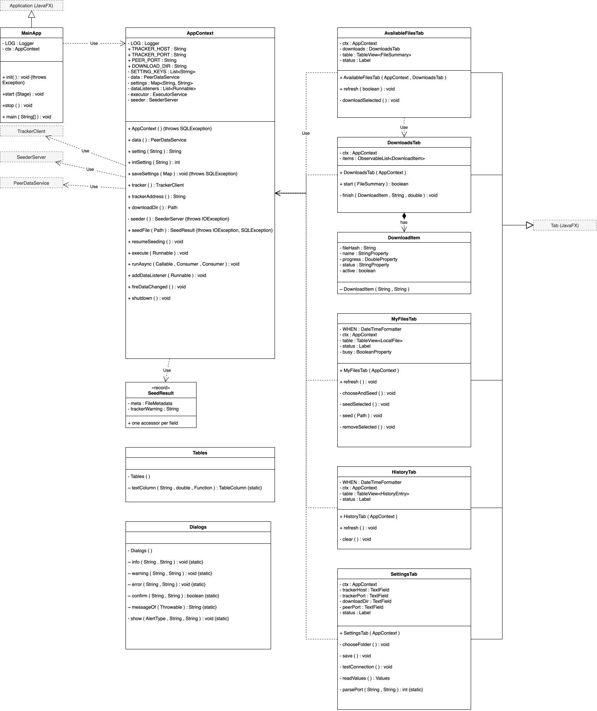
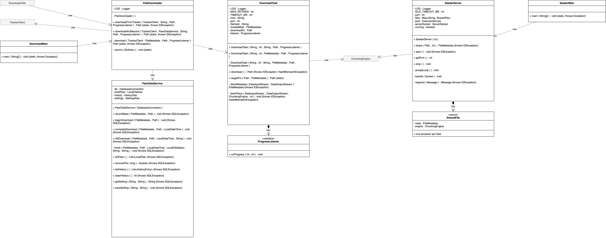
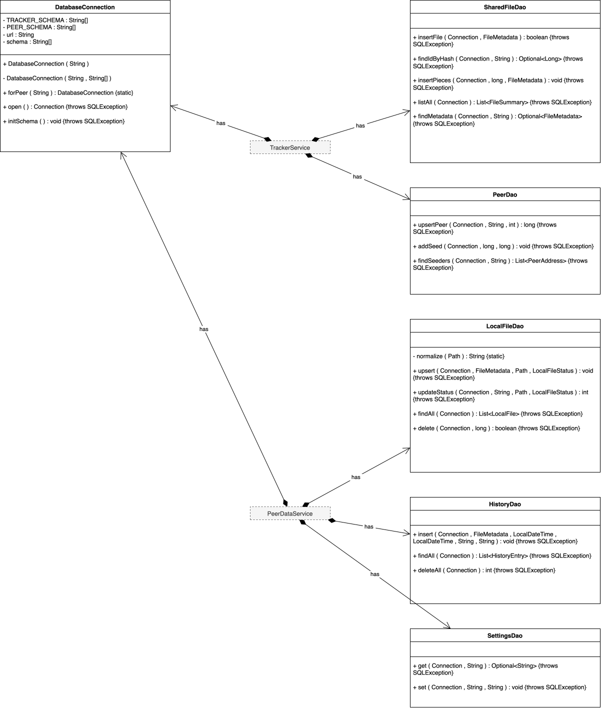
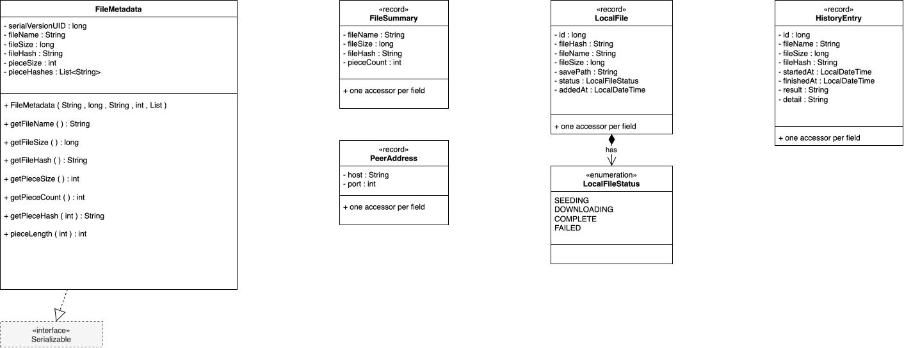

# Use Case Diagram

  

# Class Diagram

#### 1. JavaFX Application UI Classes

  

#### 2. Peer Classes (Seeder and Leecher function)

  

#### 3. Tracker Server Classes

  

#### 4. Database Classes

  

#### 5. Message Classes

  

#### 6. File Metadata Model Classes

  

#### 7. Hashing ,Chunking for storage and upload Classes

  

# Data Flow Diagrams (DFDs)
